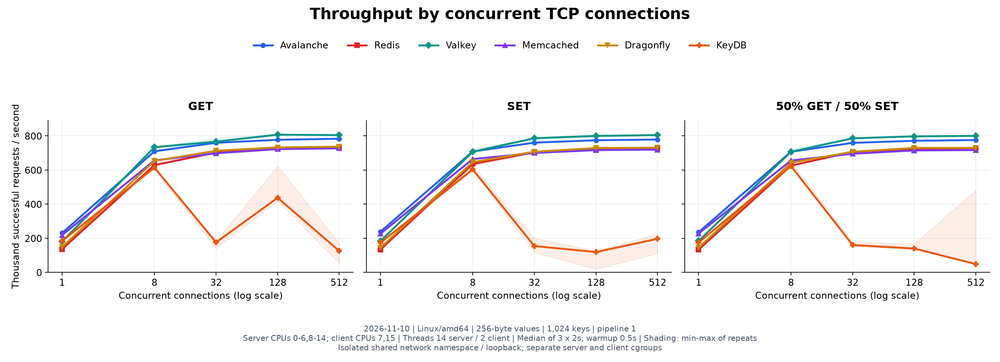
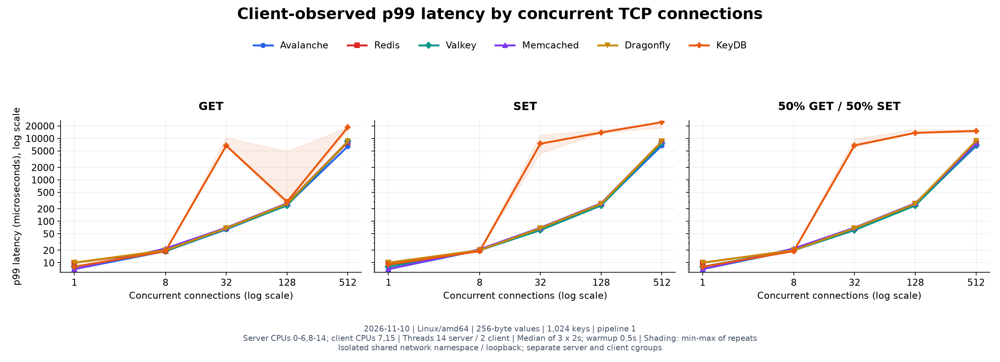
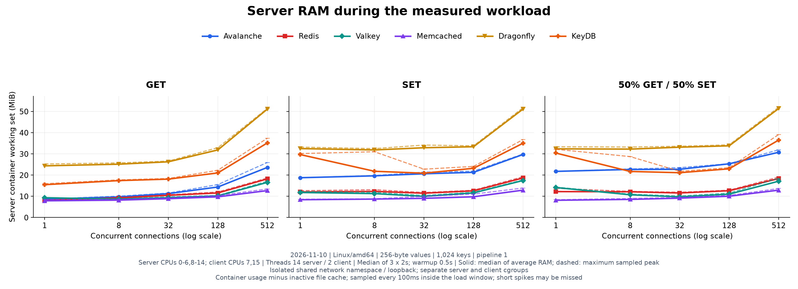

# Avalanche

Avalanche is an experimental in-memory key-value server written in Rust. It
supports binary `GET` and `SET` commands over TCP, uses Tokio for networking, and
stores values in sharded Papaya hash maps. Commands execute directly in each
connection's task through a replaceable `CommandExecutor` implementation.

## Benchmark results: trade2, 14 server threads

All six databases were measured on **AMD Ryzen 7 9700X** server with **8 physical cores / 16 SMT threads**.
The [recorded results](docs/benchmarks/assets/trade2-14t-20261110/summary.csv) contain
**270 measurements**, **302,686,199 fully validated responses**,
**zero request errors**, and **18 passed Rust database tests**, as recorded in the
[verification summary](docs/benchmarks/assets/trade2-14t-20261110/verification.json).

The server container has **14 logical CPUs on 7 physical cores**, with 14
Avalanche Tokio workers / database worker or I/O threads. Redis and Valkey use
14 I/O threads; this does not make all their command execution parallel.
The client has **2 threads on the remaining physical core**. CPU sets are
`0-6,8-14` for the server and `7,15` for the client.

Both processes run in separate native Linux/amd64 containers connected over
loopback in a shared, isolated network namespace. Server/client memory limits
are 8 GiB / 1 GiB; other databases use a 4 GiB data limit. The dataset has
1,024 eight-byte keys and 256-byte values; GET hits populated keys and SET
overwrites them. Pipeline depth is 1. Each point has three 2-second measurements
with a 0.5-second warmup; connection counts are 1, 8, 32, 128, and 512.

This is a new hardware, network, build, and storage profile compared with earlier
ARM64/Docker Desktop measurements.
Differences between those runs cannot be attributed to the thread count alone.

### Avalanche with a 14-thread client

**Avalanche achieved a median of 2,030,480 RPS (2.03 million requests per second)**
with **14 server threads, 14 client threads, and 512 concurrent connections**.
The workload alternated **50% GET / 50% SET**, with pipeline depth 1.

| Connections | Median RPS | p99, ms |
| --- | ---: | ---: |
| 128 | 1,235,255 | 0.296 |
| 512 | **2,030,480** | 0.720 |

Each point has three 2-second measurements after a 0.5-second warmup, with zero
request errors. Server CPUs were `0-6,8-14`; client CPUs were `0-15`, so the client
and server shared CPU cores. This profile was measured for Avalanche only.
The six-database comparison below uses a separate two-thread client allocation.

Sources: [summary CSV](docs/benchmarks/assets/trade2-14t-20261110/client-control-summary.csv),
[raw measurements](docs/benchmarks/assets/trade2-14t-20261110/client-control-raw.jsonl),
and [client/server configuration](docs/benchmarks/assets/trade2-14t-20261110/client-control-metadata.json).

### Throughput: six databases, two client threads

Median throughput at **128 concurrent TCP connections**, in **thousands of
validated requests per second**. Charts show every tested connection count and
the min–max range of repeats.

| Database | Version | GET | SET | 50% GET / 50% SET |
| --- | --- | ---: | ---: | ---: |
| **Avalanche** | **0.1.0** | **777.4** | **774.7** | **771.5** |
| Redis | 8.2.11 | 723.7 | 721.5 | 724.4 |
| Valkey | 9.1.3 | 807.5 | 800.3 | 797.6 |
| Memcached | 1.6.45 | 722.6 | 716.7 | 714.9 |
| Dragonfly | 2.1, build `1bfc6b18` | 732.8 | 729.3 | 729.9 |
| KeyDB | 6.3.4 | 437.6 | 119.4 | 140.0 |

KeyDB was unstable at high concurrency with 14 server threads. Its mixed result
at 128 connections ranged from **135.7 to 168.6 thousand RPS**.
A [fresh-process confirmation](docs/benchmarks/assets/trade2-14t-20261110/keydb-confirmation.json)
using three 5-second mixed windows at 128 connections produced a median of
**156.3 thousand RPS**, range **121.8–326.4 thousand RPS**.
The cause of this variability was not profiled.

### Latency

Client-observed **p99 at 128 connections**, in **milliseconds**. Each entry is the
median of the three per-run p99 values. Timing includes request transmission and
receipt and validation of the complete response. The chart uses a logarithmic latency axis.

| Database | GET p99 | SET p99 | Mixed p99 |
| --- | ---: | ---: | ---: |
| **Avalanche** | **0.248** | **0.248** | **0.248** |
| Redis | 0.264 | 0.264 | 0.264 |
| Valkey | 0.240 | 0.240 | 0.240 |
| Memcached | 0.272 | 0.272 | 0.272 |
| Dragonfly | 0.264 | 0.264 | 0.264 |
| KeyDB | 0.296 | 13.824 | 13.568 |

### RAM usage

Server-container working set at **128 connections**, in **MiB**. Each cell shows
**average / sampled peak**: the median of the repeats' average RAM, followed by
the maximum sampled peak across repeats.

| Database | GET avg / peak | SET avg / peak | Mixed avg / peak |
| --- | ---: | ---: | ---: |
| **Avalanche** | **14.36 / 15.51** | **21.28 / 21.84** | **25.30 / 25.35** |
| Redis | 11.57 / 12.02 | 12.56 / 12.85 | 12.61 / 12.87 |
| Valkey | 10.17 / 10.39 | 11.59 / 11.91 | 11.00 / 11.50 |
| Memcached | 9.72 / 10.31 | 9.76 / 11.02 | 10.02 / 10.37 |
| Dragonfly | 31.85 / 32.91 | 33.35 / 33.78 | 33.79 / 34.25 |
| KeyDB | 21.01 / 22.26 | 23.19 / 24.06 | 22.94 / 23.46 |

Working set is container memory usage minus inactive file cache. Sampling occurs
every 100 ms, only inside the measurement windows. Population, warmup, and client
memory are excluded; short spikes may be missed. The server remains running
across modes and connection counts, so allocator-retained memory is included.

### Client capacity and workload limits

In sampled high-concurrency measurement intervals, the client used a median of
**1.97 logical CPUs out of its 2-CPU allocation**. The following
[client sensitivity check](docs/benchmarks/assets/trade2-14t-20261110/client-control-summary.csv)
kept the Avalanche binary, 14 server workers, and dataset fixed. Values are median
mixed-workload throughput in **validated requests per second (RPS)**.

| Client allocation | 128 connections | 512 connections |
| --- | ---: | ---: |
| 2 threads, separate physical core | 776,908.5 | 777,832 |
| 14 threads, CPU set overlaps the server | 1,235,255 | **2,030,480** |

The wider client allocation raised throughput by up to **2.61×**, showing that the main profile's client allocation constrained the measured result.
The 14-thread client profile shares CPU cores with the server and is a separate
control; the six-database comparison above uses the isolated 2-thread client.

The measured Avalanche source has 256 Papaya maps, selected using the first two
key bytes. All 1,024 measured keys start with `00`, so they use **one map, index 96**.
This run characterizes that key distribution. Larger datasets, different keys,
and a larger independent load generator require their own measurements.

See [benchmark setup and reproduction](docs/benchmarks/README.md) for retained
data, resource allocation, and commands to reproduce the run.
